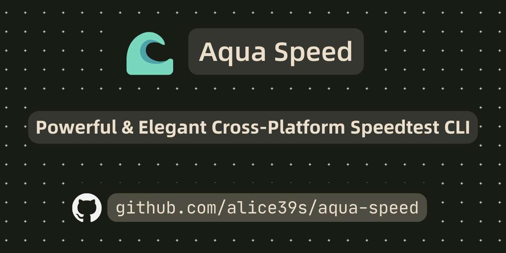

# :ocean: Aqua Speed

<div align="center" style="margin-bottom: 20px">



</div>

A modern network speed test CLI built with Bun and TypeScript.

<div align="center">

[](https://www.typescriptlang.org/)
[](https://bun.sh)
[](https://oxc.rs)
[](LICENSE)

</div>

<div align="center">

> English | [简体中文](README.zh.md)

</div>

## :star2: Features

- 🚀 High-performance speed testing powered by Bun runtime
- ✨ Multiple test servers support:
  - Apple (download & upload)
  - Cloudflare (download & upload)
  - LibreSpeed (download & upload)
  - Ookla (TODO)
  - Custom file URL (download only) [^1]
- 🧵 Concurrent testing with configurable threads
- 📊 Comprehensive metrics:
  - TCP/ICMP/HTTP latency
  - Download/Upload speeds
  - Jitter analysis
- 🎨 Beautiful CLI interface with real-time progress
- 🛡️ Full TypeScript type support, Oxc constrained code style.

## :star: Supported Servers

| Server Type      | Upload                 | Download               | Latency                | Remarks                 |
| ---------------- | ---------------------- | ---------------------- | ---------------------- | ----------------------- |
| Speedtest.net    | :large_orange_diamond: | :large_orange_diamond: | :large_orange_diamond: | Development             |
| LibreSpeed       | :white_check_mark:     | :white_check_mark:     | :white_check_mark:     |                         |
| Cloudflare Speed | :white_check_mark:     | :white_check_mark:     | :white_check_mark:     | speed.cloudflare.com    |
| Apple            | :white_check_mark:     | :white_check_mark:     | :white_check_mark:     | mensura.cdn-apple.com   |
| Single File      | :x:                    | :white_check_mark:     | :white_check_mark:     | Not support upload test |
| Looking Glass    | :large_orange_diamond: | :white_check_mark:     | :white_check_mark:     | Development             |
| Taierspeed       | :large_orange_diamond: | :large_orange_diamond: | :large_orange_diamond: | Development             |
| Speedtest.cn     | :large_orange_diamond: | :large_orange_diamond: | :large_orange_diamond: | Development             |

# :star2: Demo

[](https://asciinema.org/a/nlNFF30p1fHw5iwm8eXEmRqq0)

## :fire: Run

### :rocket: Run from CI Build

Download the latest binary compressed package from [Releases](https://github.com/Alice39s/aqua-speed/releases)

#### Linux & macOS

```bash
chmod +x aqua-speed
./aqua-speed
```

#### Windows

```bash
./aqua-speed.exe
```

### :whale: Run from Docker

```bash
docker run -it ghcr.io/alice39s/aqua-speed:latest
```

### :hammer_and_wrench: Run from Source

#### 1. Install Bun

```bash
# Linux & macOS
curl -fsSL https://bun.sh/install | bash

# Windows
powershell -c "irm bun.sh/install.ps1 | iex"

# Windows (Package Manager)
scoop install bun
```

#### 2. Clone repository

```bash
git clone https://github.com/Alice39s/aqua-speed.git
```

#### 3. Install dependencies

```bash
bun install
```

Requires Bun 1.4.4 or newer. Dependencies are pinned in `bun.lock`; use `bun install --frozen-lockfile` for reproducible installs.

TypeScript 7 checks use the native `tsgolint` engine through `bun run typecheck`.

#### 4. Run

```bash
bun run start
```

## Basic Usage

### Quick Start

```bash
# Run with defaults (Cloudflare server, 4 threads)
aqua-speed

# Test against Apple CDN
aqua-speed --type Apple

# Test against LibreSpeed server
aqua-speed --type LibreSpeed

# Test with custom file URL
aqua-speed -s https://example.com/testfile.dat
```

### Advanced Options

```bash
aqua-speed [options]

Options:
  -s, --server <url>     Speed test server URL
  --sn <name>            Speed test server name
  -t, --thread <number>  Number of concurrent connections
  --timeout <seconds>    Maximum seconds per download/upload phase (default: 30)
  --max-data <MB>        Maximum decimal MB per direction (default: adaptive)
  --debug               Debug mode
  --type <type>         Test type (SingleFile|LibreSpeed|Cloudflare|Apple)
```

## :mag: Example Output

```
Test Results:

    Latency:
        TCP: min = 1.25 ms, avg = 2.19 ms, max = 3.38 ms
        ICMP: min = 1.00 ms, avg = 1.00 ms, max = 1.00 ms
        HTTP: min = 97.74 ms, avg = 100.71 ms, max = 103.68 ms

    Speed:
        Download: min = 570.55 Mbps, avg = 1.17 Gbps, max = 1.36 Gbps
        Upload: min = 601.25 Mbps, avg = 1.20 Gbps, max = 1.39 Gbps

    Test Information:
        Server: speed.cloudflare.com
        Time: 2024/12/25 12:00:00
```

## :bug: Troubleshooting

### Common Issues

1. `Permission denied`

```bash
chmod +x aqua-speed
```

2. Low speeds

- Reduce threads: `-t 2`
- Test with different servers

### Debug Mode

Enable debug logging for detailed information:

```bash
./aqua-speed --debug
```

## :hammer_and_wrench: Development

```bash
# Install dependencies
bun install

# Run in development
bun run dev

# Run tests
bun test

# Build binary
bun run build:binary
```

### :scroll: Code Style

Oxfmt formats the code. Oxlint and its `tsgolint` engine run lint rules and TypeScript 7 diagnostics in one pass:

```bash
# Format code
bun run format

# Lint and type-check code
bun run lint

# Run all checks
bun run check
```

## :book: Changelog

See [CHANGELOG.md](CHANGELOG.md) for more details.

## :construction: Roadmap

See [Roadmap.md](Roadmap.md) for more details.

## :fork_and_knife: Contributing

1. Fork repository
2. Create feature branch
3. Commit changes
4. Run tests
5. Submit pull request

Please ensure:

- Tests pass
- Code follows Oxc standards
- Commit messages are clear
- Documentation is updated

## :scroll: License

[GPL-3.0 License](LICENSE)

## :pray: Acknowledgements

- [Bun](https://bun.sh) - JavaScript runtime & toolkit
- [LibreSpeed](https://github.com/librespeed/speedtest) - Open source speed test
- All contributors

[^1]: Recommended to specify a file of at least 10MB.

Apple tests use the CDN capacity endpoints for download, upload, and idle latency. `--server` can select another server exposing `/api/v1/gm/{small,large,slurp}`. These results use Aqua Speed metrics; they do not include the macOS `networkQuality` responsiveness (RPM) calculation.

### Adaptive completion

`--timeout` is the maximum duration of each transfer phase. Downloads and uploads can finish earlier once aggregate throughput stabilizes across all requested connections. Unless the traffic budget is reached first, the default test runs for at least five seconds, skips the first second of startup, then checks a rolling two-second window for low variation and a flat linear trend. The window must stay stable for another 600 ms. Ramps, stalls, and persistent oscillation continue until the traffic budget or deadline.

Uploads report payload as 64 KiB pieces are handed to the transport. Upload convergence fits overlapping one-second byte-growth windows every 200 ms, avoiding finite-POST boundary aliasing without changing the default 5% tolerance. Downloads retain 200 ms observations. Result statistics retain the unsmoothed intervals.

The CLI marks a stable result as `stable, stopped early`. Active requests are cancelled and settled before the next phase starts; byte totals retain completed transfer progress. Connection count stays fixed at `--thread` during the measurement. Library callers can tune `minTestTime` and `targetError`; `SpeedStats.stopReason` is `stable`, `budget`, or `timeout`.

### Traffic budget

Traffic limits are enabled by default for every provider. After about three seconds and at least one second since the first observed traffic, the upper quartile of post-startup throughput samples selects a budget equivalent to ten seconds at that speed, clamped to 250 MB through 2.5 GB **per direction**. The budget then stays fixed, including across retries and fallback endpoints. Startup bytes remain charged; if they already exceed the estimated budget, the phase stops with the bytes actually spent. Before calibration, the 2.5 GB ceiling applies.

| Estimated speed  | Budget per direction | Download + upload at that speed |
| ---------------- | -------------------- | ------------------------------- |
| 100 Mbps         | 250 MB               | 500 MB                          |
| 1 Gbps           | 1.25 GB              | 2.5 GB                          |
| 2 Gbps or faster | 2.5 GB               | 5 GB                            |

These are decimal application-payload budgets, not target transfer sizes. Stable connections normally stop sooner. The ten-second scale and 250 MB floor are informed by [M-Lab's analysis of shorter tests](https://www.measurementlab.net/blog/short-ndt/), which also found greater error on fast connections with small fixed caps. This adaptive policy is an Aqua Speed design choice; its accuracy has not been validated against that dataset.

On budget exhaustion the CLI shows `traffic budget reached`, never a stability claim. Downloads are cancelled as soon as a received chunk reaches the limit; the final chunks and data already in flight can exceed it. Uploads reserve request bodies before sending, shrink the final payload to fit, and charge failed or cancelled attempts. LibreSpeed multipart overhead is included. Already-reserved uploads finish within the phase deadline. Probes, HTTP/TLS/IP headers, retransmissions, and cancellation buffers are outside this accounting, so an ISP's traffic counter can be higher.

Use `--max-data 100` to set a fixed 100 MB budget for each direction, including startup. Library callers can set `maxTransferBytes` in bytes. Results expose `trafficBytes` (including reserved uploads and failed attempts) and `trafficLimitBytes`; `totalBytes` retains received download payload or upload payload handed to the transport, including failed and unfinished requests. `runSpeedTest` retains each direction's ledger across phase retries. Callers that implement their own retries around `measureDownload` or `measureUpload` can reuse a `trafficBudget` from `createTrafficBudget` exported by the library.
