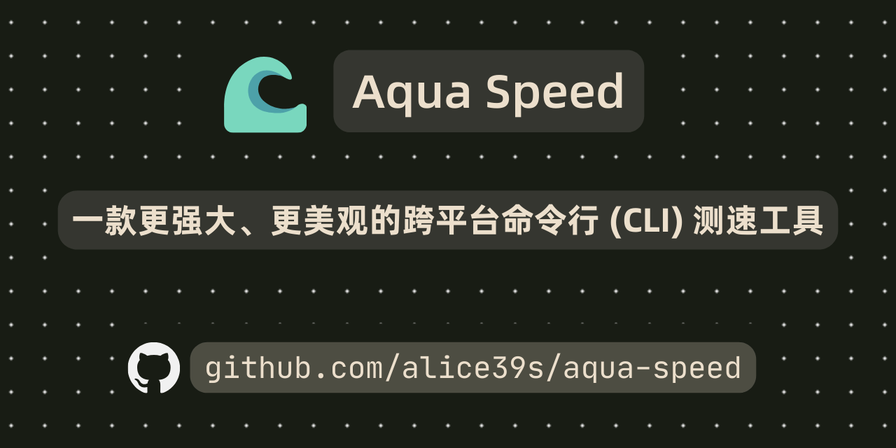

# :ocean: Aqua Speed

<div align="center" style="margin-bottom: 20px">



</div>

一个使用 Bun 和 TypeScript 构建的现代网络测速 CLI 工具。

<div align="center">

[](https://www.typescriptlang.org/)
[](https://bun.sh)
[](https://oxc.rs)
[](LICENSE)

</div>

<div align="center">

> 简体中文 | [English](README.md)

</div>

> [!IMPORTANT]
> 如本文和 [README.md](README.md) (英文版本) 不一致，请以前者为准。

## :star2: 特性一览

- 🚀 使用 Bun.sh 高性能 JS Runtime 构建，冷启动快、内存占用低
- ✨ 支持多种测速服务器：
  - Cloudflare (下载 & 上传)
  - LibreSpeed (下载 & 上传)
  - Ookla (开发中)
  - 自定义文件 URL (暂不支持测试上传) [^1]
- 🧵 可自由配置并发测速线程数
- 📊 可测试以下指标：
  - TCP/ICMP/HTTP 延迟
  - 下载/上传速度
  - 抖动分析
- 🎨 美观的 CLI 界面，支持实时进度显示
- 🛡️ 完备的 TypeScript 类型支持、使用 Oxc 约束代码风格

## :star: 支持的测速服务端

| 测速服务端        | 上传测速               | 下载测速               | 延迟测试               | 备注                  |
| ----------------- | ---------------------- | ---------------------- | ---------------------- | --------------------- |
| Speedtest.net     | :large_orange_diamond: | :large_orange_diamond: | :large_orange_diamond: | 开发中、高优先级      |
| LibreSpeed        | :white_check_mark:     | :white_check_mark:     | :white_check_mark:     | 主要用于高校测速站    |
| Cloudflare Speed  | :white_check_mark:     | :white_check_mark:     | :white_check_mark:     | speed.cloudflare.com  |
| Apple             | :white_check_mark:     | :white_check_mark:     | :white_check_mark:     | mensura.cdn-apple.com |
| 单文件测速        | :x:                    | :white_check_mark:     | :white_check_mark:     | 不支持上传测速        |
| Looking Glass     | :large_orange_diamond: | :white_check_mark:     | :white_check_mark:     | 开发中                |
| 全球网测 (信通院) | :large_orange_diamond: | :large_orange_diamond: | :large_orange_diamond: | 开发中                |
| Speedtest.cn      | :large_orange_diamond: | :large_orange_diamond: | :large_orange_diamond: | 开发中                |

# :star2: 演示

[](https://asciinema.org/a/nlNFF30p1fHw5iwm8eXEmRqq0)

## :rocket: 启动

### 使用二进制启动

从 [Releases](https://github.com/Alice39s/aqua-speed/releases) 下载最新的二进制文件压缩包

#### :penguin: Linux & :apple: macOS

```bash
chmod +x aqua-speed
./aqua-speed
```

#### :window: Windows

```bash
./aqua-speed.exe
```

### :whale: Docker Run

```bash
docker run -it ghcr.io/alice39s/aqua-speed:latest
```

### :hammer_and_wrench: 从源代码运行

#### 1. 安装 Bun

```bash
# Linux & macOS
curl -fsSL https://bun.sh/install | bash

# Windows
powershell -c "irm bun.sh/install.ps1 | iex"

# Windows (包管理器)
scoop install bun
```

#### 2. 克隆仓库

```bash
git clone https://github.com/Alice39s/aqua-speed.git
```

#### 3. 安装依赖

```bash
bun install
```

需要 Bun 1.4.4 或更新版本。依赖版本记录在 `bun.lock` 中，可用 `bun install --frozen-lockfile` 按锁文件安装。

运行 `bun run typecheck`，通过原生 `tsgolint` 引擎执行 TypeScript 7 检查。

#### 4. 运行

```bash
bun run start
```

## :book: 基本用法

### :rocket: 快速开始

```bash
# 使用默认设置运行 (Cloudflare 服务器, 4 线程)
aqua-speed

# 测试 LibreSpeed 服务器
aqua-speed --type LibreSpeed --server https://speed.example.com

# 使用自定义文件 URL 测试
aqua-speed --type SingleFile -s https://example.com/testfile.dat
```

### 自定义服务器与 DNS

Cloudflare 和 Apple 提供默认服务器；LibreSpeed、SingleFile 和 Ookla 必须指定 `--server`。自定义 URL 仅支持 HTTP 和 HTTPS，配置无效时会在联网前报错。未提供 `--sn` 时，显示名称采用自定义服务器的主机名。

查询服务器 IP 信息时先使用系统 DNS，再尝试 Cloudflare 和阿里云的 JSON DoH 服务。重复传入 `--doh-server`，或用逗号分隔的 `AQUA_SPEED_DOH_SERVERS` 环境变量，可以替换回退服务列表，命令行参数优先。`--no-doh` 或空的环境变量值表示仅使用系统 DNS。每次 DNS 请求及 DoH 响应体读取最多等待两秒。DoH URL 必须使用 HTTPS，本机回环地址允许 HTTP。IP 地址直接跳过 DNS 查询。这些选项只影响服务器信息查询，实际测速连接使用运行时的 DNS 解析。

```bash
aqua-speed --type LibreSpeed --server https://speed.example.com --no-doh
aqua-speed --doh-server https://dns.example.com/resolve --doh-server https://backup.example.com/resolve
```

### :hammer_and_wrench: 高级选项

```bash
aqua-speed [options]

Options:
  -s, --server <url>     测速服务器 URL
  --sn <name>            测速服务器名称
  -t, --thread <number>  并发连接数
  --timeout <seconds>    每个下载／上传阶段的最长秒数（默认 30）
  --max-data <MB>        每个方向的十进制 MB 上限（默认自动估算）
  --ipinfo-token <token> IPInfo Token（环境变量：IPINFO_TOKEN 或 IPINFO_API_KEY）
  --no-geoip            跳过 IP 发现与归属地查询
  --debug               调试模式
  --doh-server <url>     JSON DoH 地址，可重复设置回退顺序
  --no-doh              服务器信息查询仅使用系统 DNS
  --type <type>         测试类型 (SingleFile|LibreSpeed|Cloudflare|Apple)
```

### GeoIP 服务

归属地查询依次尝试 GeoJS、IPInfo.es、FreeIPAPI、WP Statistics MaxMind、WP Statistics DB-IP，最后尝试 IPInfo。配置 `--ipinfo-token` 后优先使用带认证的 IPInfo；也可使用 `IPINFO_TOKEN` 或 `IPINFO_API_KEY` 环境变量，按此顺序取值，命令行参数优先。Token 仅通过 Authorization 请求头发送给 IPInfo。

每个服务的请求及响应体读取最多等待三秒，整次查询最多等待十秒。限流、无效 JSON、空数据和 IP 不匹配都会尝试下一个服务。查询本机出口 IP 时使用支持自动识别地址的 GeoJS、FreeIPAPI 和 IPInfo。归属地服务不可用时，测速继续运行，并显示信息不可用。`--no-geoip` 会跳过 IP 发现、归属地查询及 Cloudflare 机房信息查询。缺失字段显示为不可用；FreeIPAPI 返回的国家时区列表不会作为该 IP 的时区。

## :mag: 示例输出

```
Test Results:

    Latency:
        TCP: min = 1.25 ms, avg = 2.19 ms, max = 3.38 ms
        ICMP: min = 1.00 ms, avg = 1.00 ms, max = 1.00 ms
        HTTP: min = 97.74 ms, avg = 100.71 ms, max = 103.68 ms

    Speed:
        Download: min = 570.55 Mbps, avg = 1.17 Gbps, max = 1.36 Gbps
        Upload: min = 601.25 Mbps, avg = 1.20 Gbps, max = 1.39 Gbps

    Test Information:
        Server: speed.cloudflare.com
        Time: 2024/12/25 12:00:00
```

## :bug: 故障排除

### 常见问题

1. `Permission denied`

请确保文件有执行权限，使用 `chmod +x aqua-speed` 赋予执行权限。

2. 速度慢

- 减少线程数: `-t 2`
- 更换其他测速服务器

### :mag: 调试模式

启用调试日志以获取详细信息:

```bash
./aqua-speed --debug
```

## :hammer_and_wrench: 开发

```bash
# 安装依赖
bun install

# 在开发模式下运行
bun run dev

# 运行测试
bun test

# 构建二进制文件
bun run build:binary
```

### :scroll: 代码风格

本项目使用 Oxc 进行代码格式化和 lint (使用 `oxfmt` 和 `oxlint --type-aware --type-check`):

```bash
# 格式化代码
bun run format

# 代码检查
bun run lint

# 运行全部检查
bun run check
```

## :fork_and_knife: 贡献

1. Fork 仓库
2. 创建特性分支
3. 提交更改
4. 运行测试
5. 提交 pull request

请确保：

- 测试通过
- 代码遵循 Oxc 标准
- 提交信息清晰
- 文档已更新

## :book: 更新日志

参见 [CHANGELOG.md](CHANGELOG.md) 获取更多详细信息。

## :construction: 路线图

参见 [Roadmap.md](Roadmap.md) 获取更多详细信息。

## :scroll: 许可证

[GPL-3.0 License](LICENSE)

## :pray: 致谢

- [Bun](https://bun.sh) - JavaScript 运行时和工具包
- [LibreSpeed](https://github.com/librespeed/speedtest) - 开源测速工具
- 所有贡献者

[^1]: 自定义文件 URL 暂不支持测试上传，仅支持下载、推荐指定 10MB 以上的文件。

Apple 测速：`aqua-speed --type Apple`。支持下载、上传和空闲延迟测量，可用 `--server` 指定提供 `/api/v1/gm/{small,large,slurp}` 接口的服务。结果使用 Aqua Speed 的指标，不包含 macOS `networkQuality` 的响应性（RPM）计算。

### 稳定后提前结束

`--timeout` 表示每个传输阶段的最长时长。所有指定连接的总吞吐量稳定后，下载和上传可以提前结束。除非先耗尽流量预算，默认至少测量五秒，跳过最初一秒的起步阶段，再检查最近两秒的波动幅度和线性拟合趋势；稳定状态还需持续 600 毫秒。持续升速、停顿和反复波动会继续测到流量预算或截止时间。

上传每向传输层交付 64 KiB 数据就报告进度。上传收敛每 200 毫秒检查最近一秒的重叠字节增长窗口，避免有限 POST 边界造成采样混叠，默认 5% 阈值不变。下载仍使用 200 毫秒观测，结果统计保留未经平滑的间隔。

稳定后结束时，CLI 显示 `stable, stopped early`。程序取消剩余请求，等待连接收尾后进入下一阶段，并保留传输字节统计。测量期间按 `--thread` 保持固定连接数。库调用可通过 `minTestTime` 和 `targetError` 调整判断条件；`SpeedStats.stopReason` 返回 `stable`、`budget` 或 `timeout`。

### 默认流量预算

所有测速类型默认启用流量限制。约三秒后且首次观测到流量至少一秒后，算法使用跳过起步阶段后的吞吐量样本上四分位数，计算相当于该速度传输十秒的预算，限制在**每个方向 250 MB 至 2.5 GB**。预算一旦确定就不再增加，重试和切换后备端点也不会重置。起步流量照常扣除；若已超过估算预算，立即按实际消耗结束。估算完成前同样受 2.5 GB 上限约束。

| 估算速度      | 每个方向的预算 | 下载与上传均为该速度时的合计预算 |
| ------------- | -------------- | -------------------------------- |
| 100 Mbps      | 250 MB         | 500 MB                           |
| 1 Gbps        | 1.25 GB        | 2.5 GB                           |
| 2 Gbps 及以上 | 2.5 GB         | 5 GB                             |

以上均为十进制应用层数据预算，不是必须消耗的流量；连接稳定时通常会更早结束。十秒的测量尺度和 250 MB 下限参考了 [M-Lab 的短测速研究](https://www.measurementlab.net/blog/short-ndt/)，其中也指出小额固定上限对高速连接的误差影响更大。本项目的自适应策略并未使用该数据集验证精度。

预算耗尽时，CLI 显示 `traffic budget reached`，不会宣称速度已经稳定。下载在收到的数据块达到预算时立即取消，最后的数据块和已在途数据可能造成少量超出。上传发送前预留请求额度，最后一笔按剩余额度缩小；失败和取消的请求不会退还额度，LibreSpeed 的 multipart 包装也计入预算。已预留的上传会在阶段截止时间内收尾。探测请求、HTTP/TLS/IP 头、重传和取消时的缓冲数据不在统计范围内，因此运营商账单流量可能更高。

可用 `--max-data 100` 将每个方向固定为 100 MB，包含起步流量；库调用则设置字节单位的 `maxTransferBytes`。结果通过 `trafficBytes` 返回已扣流量（含预留上传和失败请求），通过 `trafficLimitBytes` 返回预算；`totalBytes` 为实际收到的下载数据或已交付传输层的上传有效载荷，包含失败和未完成请求。`runSpeedTest` 会在阶段重试间保留预算；自行重试 `measureDownload` 或 `measureUpload` 的调用方可复用 库导出的 `createTrafficBudget` 所创建的 `trafficBudget`。
